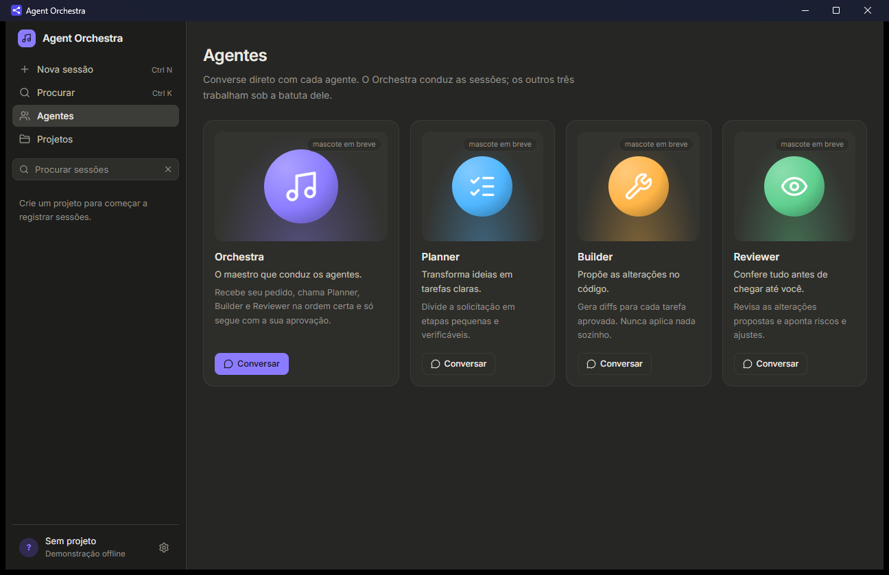

# Agent Orchestra

[](https://github.com/Efer-Eder/agent-orchestra/actions/workflows/ci.yml)
[](LICENSE)

[🇧🇷 Português](README.md) · 🇺🇸 English · **[Project page and live demo](https://efer.online/projeto/agent-orchestra/)**

> **In development.** Not a finished product yet. It runs in the browser or in a desktop window (Tauri 2) on Windows, either in **offline demo mode** or with an **OpenAI-compatible provider** using your own key. There is no published installer, no access to project files and no command execution.

Agent Orchestra aims to be a **local-first** desktop app (Tauri 2 + React) for coordinating AI agents in a development workflow with three roles — **Planner**, **Builder** and **Reviewer** — and **human approval** before anything runs.



## What works now

- Desktop-chat-style interface ([DESIGN.md](DESIGN.md), **Grafite** theme): sidebar with sessions grouped by date and search, conversation with the agents, details panel and light/dark/system theme.
- **request → plan → approval → execution → review** flow, with rejection, adjustment requests and cancellation at any time.
- **Real OpenAI-compatible provider** (OpenAI, OpenRouter, Groq, Ollama, LM Studio…): base URL, model and key in Settings, with a connection test and clear messages for 401, 429, timeouts and network failures.
- **Offline demo mode**, no network and no key, with clearly labelled replies.
- **Agents** section: chat directly with Orchestra, Planner, Builder and Reviewer. Mascots are still to be designed; placeholders for now.
- The Builder only **proposes** diffs, shown in the side panel; nothing is written to disk. Paths outside the project are rejected.
- Projects, sessions and chats are saved on this device. **The API key never goes into app files**: in the desktop app you can keep it in the **Windows Credential Manager**; in the browser it stays in memory only.
- Token usage as reported by the provider (synthetic in demo mode). Cost is not estimated until a configurable price table exists.

The UI is currently in Brazilian Portuguese.

## Run locally (Windows, macOS or Linux)

Requires Node.js 22 or newer.

```powershell
git clone https://github.com/Efer-Eder/agent-orchestra.git
cd agent-orchestra
npm install
npm run dev
```

Open <http://localhost:5173>, create a project, describe a request and approve the plan. To just look around, the same build runs in demo mode at <https://efer.online/projeto/agent-orchestra/demo/>.

| Command             | What it does                  |
| ------------------- | ----------------------------- |
| `npm test`          | Tests (Vitest)                |
| `npm run lint`      | ESLint                        |
| `npm run typecheck` | Type checking                 |
| `npm run build`     | Production build into `dist/` |

## Desktop app (Windows)

Requires Rust (MSVC) and Microsoft C++ Build Tools — see [docs/tauri-setup.md](docs/tauri-setup.md) (in Portuguese).

```powershell
npm run tauri dev
```

No installer is published and there is no code signing.

## Not built yet

Published installer, reading project files as context, applying diffs to disk, command execution, SQLite persistence, session export and the mascots. See the [ROADMAP](ROADMAP.md) and [progress log](PROGRESS.md) (in Portuguese).

## Security

- No telemetry. Network is used only when you configure a real provider, and only to that address.
- The API key is sent only to the configured provider. On desktop it can live in the Windows Credential Manager; never in app files.
- The project **does not provide a sandbox**; command execution is out of scope until isolation is demonstrated.
- See the [threat model](docs/threat-model.md) and [security policy](SECURITY.md).

## License

[MIT](LICENSE) © 2026 Efer Eder
