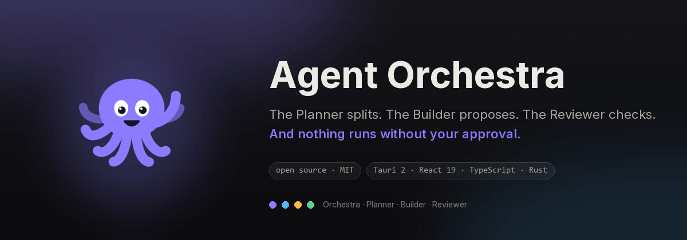
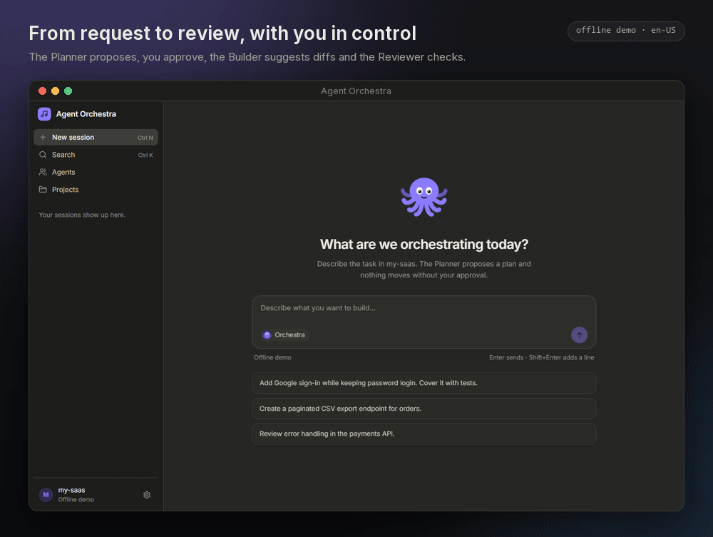
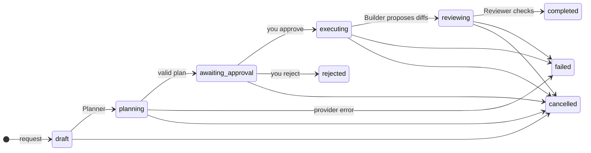
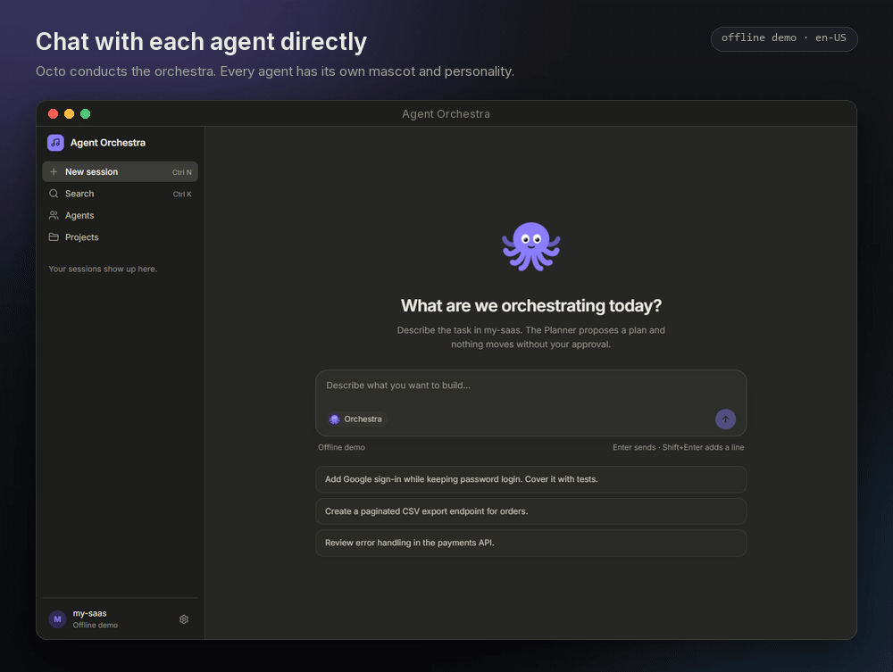
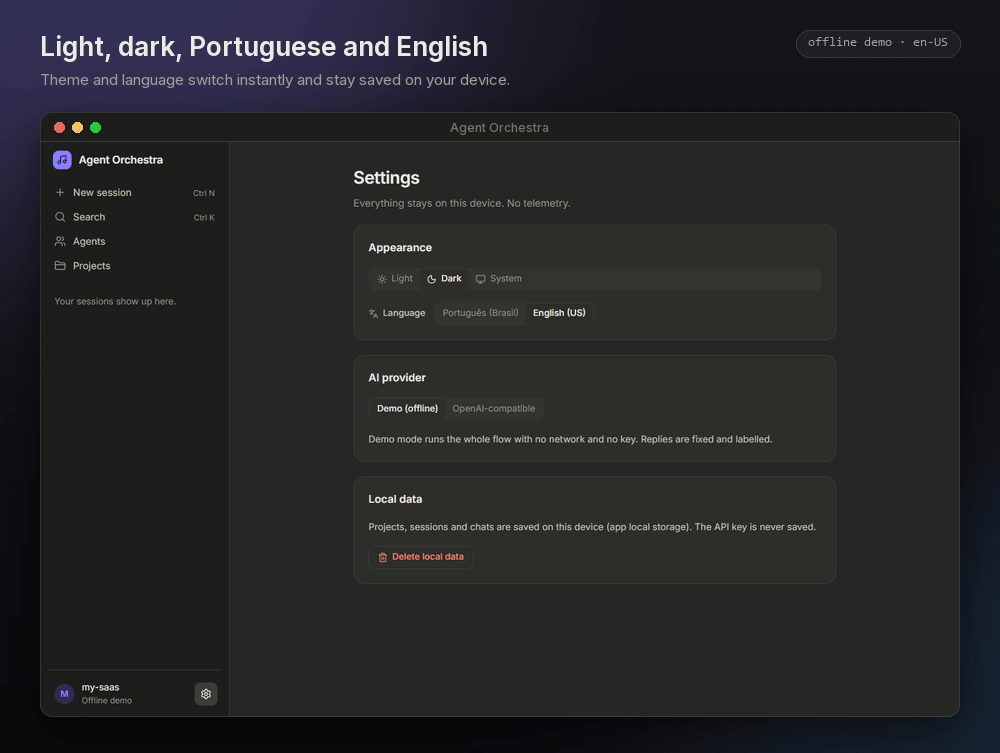

<p align="center">
  
</p>

<p align="center">
  <a href="https://github.com/Efer-Eder/agent-orchestra/actions/workflows/ci.yml"></a>
  <a href="LICENSE"></a>
  <a href="https://efer.online/projeto/agent-orchestra/demo/?lang=en"></a>
  
  
</p>

<p align="center">
  <a href="https://efer.online/projeto/agent-orchestra/demo/?lang=en"><b>Open the demo</b></a> ·
  <a href="https://efer.online/projeto/agent-orchestra/">Project page</a> ·
  <a href="docs/architecture.md">Architecture</a> ·
  <a href="ROADMAP.md">Roadmap</a> ·
  <a href="README.md">Português</a>
</p>

> [!NOTE]
> **In development.** The full flow works in the browser and in the desktop app (Windows), in demo mode or with a real AI provider. There is no published installer, no reading of project files and no command execution yet. Everything shown here exists and runs today.

## What it is

Agent Orchestra is a **local-first** desktop app for coordinating AI agents in your development workflow. The **Planner** breaks the request into tasks, the **Builder** proposes diffs and the **Reviewer** checks them. Between the plan and the execution there is a gate that only you can open.

<p align="center">
  
</p>

## Why

- **You decide.** The domain is a state machine: the only transition into `executing` goes through `approvePlan()`, which is your click. A test makes sure of it.
- **Your machine, your keys.** No telemetry. The API key lives in the Windows Credential Manager (or only in memory, in the browser) and goes straight to the provider you pick.
- **Any model.** Works with any OpenAI-compatible API, including local models. And a demo mode runs the whole flow with no network and no key.

## Features

|                        |                                                                                                                                                           |
| ---------------------- | --------------------------------------------------------------------------------------------------------------------------------------------------------- |
| **Approval flow**      | Request → plan → approval → execution → review, with rejection, adjustment requests and cancellation at any time.                                         |
| **Diffs, not writes**  | The Builder only proposes changes, which you open in the side panel. Paths outside the project (`../`, absolute, `C:\`, `~`) are rejected.                |
| **Real provider**      | OpenAI, OpenRouter, Groq, Ollama, LM Studio and friends, with a connection test and clear messages for 401, 429, timeouts and network errors.             |
| **Agents with a face** | **Octo** conducts the orchestra and changes mood with the session; Planner, Builder and Reviewer come alive while they work. Chat with each one directly. |
| **Two languages**      | UI, demo mode and model answers in **English (US)** or **Portuguese (Brazil)**.                                                                           |
| **Light and dark**     | Light, dark or system theme, in the Grafite look described in [DESIGN.md](DESIGN.md).                                                                     |
| **Local-first**        | Projects, sessions and chats are saved on your device. Interrupted sessions come back marked, nothing stays "running" forever.                            |

## How it works



Model output is treated as **untrusted data**: plan, diffs and review go through type, size and path validation before they reach the screen ([`src/providers/parse.ts`](src/providers/parse.ts)).

## The agents

<p align="center">
  
</p>

| Agent                | Role                                                                                                        |
| -------------------- | ----------------------------------------------------------------------------------------------------------- |
| **Orchestra** (Octo) | The conductor. Takes the request, calls the others in the right order and only moves on with your approval. |
| **Planner**          | Breaks the request into small, verifiable steps.                                                            |
| **Builder**          | Proposes changes as diffs. Never applies anything on its own.                                               |
| **Reviewer**         | Reviews the changes and points out risks, edge cases and missing tests.                                     |

## Getting started

You need **Node.js 22+**.

```bash
git clone https://github.com/Efer-Eder/agent-orchestra.git
cd agent-orchestra
npm install
npm run dev
```

Open <http://localhost:5173>, create a project and describe a task. To just look around, the same build runs in demo mode at <https://efer.online/projeto/agent-orchestra/demo/?lang=en>.

<details>
<summary><b>Desktop app (Windows)</b></summary>

<br />

Requires Rust (MSVC) and the Microsoft C++ Build Tools. Details in [docs/tauri-setup.md](docs/tauri-setup.md) (Portuguese).

```powershell
winget install --id Rustlang.Rustup
rustup default stable-msvc
npm run tauri dev
```

No published installer and no code signing yet.

</details>

<details>
<summary><b>All commands</b></summary>

<br />

| Command                              | What it does                                   |
| ------------------------------------ | ---------------------------------------------- |
| `npm run dev`                        | App in the browser, at <http://localhost:5173> |
| `npm run tauri dev`                  | Desktop app                                    |
| `npm test`                           | Tests (Vitest)                                 |
| `npm run lint` · `npm run typecheck` | ESLint and TypeScript                          |
| `npm run build`                      | Production build into `dist/`                  |
| `npm run build:site`                 | Project page + demo, into `dist-site/`         |

</details>

## Providers

In **Settings → AI provider**, choose _OpenAI-compatible_ and enter the address, model and key.

| Provider   | Address                          |
| ---------- | -------------------------------- |
| Demo       | none, runs offline               |
| OpenAI     | `https://api.openai.com/v1`      |
| OpenRouter | `https://openrouter.ai/api/v1`   |
| Groq       | `https://api.groq.com/openai/v1` |
| Ollama     | `http://localhost:11434/v1`      |
| LM Studio  | `http://localhost:1234/v1`       |

`http://` is only accepted for `localhost`. Usage is billed by the provider, separately from any chat subscription.

## Languages and themes

<p align="center">
  
</p>

The language follows your system the first time, can be changed in Settings and stays saved. Agents answer in the chosen language. To help with translations, the strings live in [`src/i18n/messages.ts`](src/i18n/messages.ts), and TypeScript flags any missing key.

## Security

- No telemetry. The network is only used when you configure a provider, and only for that address.
- The key never goes into app files, logs or error messages.
- The Tauri shell has no file system, shell or HTTP plugins. It has just three key commands, each with an explicit permission, plus a strict CSP.
- **There is no sandbox.** Command execution stays out until isolation is demonstrated.

Read the [threat model](docs/threat-model.md) and the [security policy](SECURITY.md) (Portuguese). For vulnerabilities, use GitHub private reporting, not a public issue.

## Architecture

```text
src/
  domain/      types, state machine, provider contract, agent profiles
  providers/   demo mode, OpenAI-compatible, model output validation
  app/         state, local persistence, bridge to the Windows vault
  i18n/        pt-BR and en-US dictionaries, language detection
  components/  UI (sidebar, session, agents, mascots, settings)
src-tauri/     Rust desktop shell (key vault)
docs/          architecture, threat model, ADRs 0001 to 0008
```

The domain is pure TypeScript with no I/O, with an injectable clock and ids for deterministic tests. Decisions live in [docs/adr](docs/adr/).

## Roadmap

- [x] Full approval flow, demo mode and OpenAI-compatible provider
- [x] Windows desktop app with the key in the Credential Manager
- [x] Mascots, light and dark themes, Portuguese and English
- [ ] Read project files as context, with a directory allowlist
- [ ] Apply approved diffs to disk, with per-file approval
- [ ] HTTP calls from the Rust side, so the key never touches JavaScript
- [ ] SQLite, session export and a published installer

Full list in [ROADMAP.md](ROADMAP.md) and history in [PROGRESS.md](PROGRESS.md) (Portuguese).

## Contributing

Issues and small PRs are welcome. Before opening a PR, run `npm run lint`, `npm run typecheck`, `npm test` and `npm run build`. New domain logic comes with tests. See [CONTRIBUTING.md](CONTRIBUTING.md) and the [Code of Conduct](CODE_OF_CONDUCT.md) (Portuguese).

## License

[MIT](LICENSE) © 2026 Efer Eder
