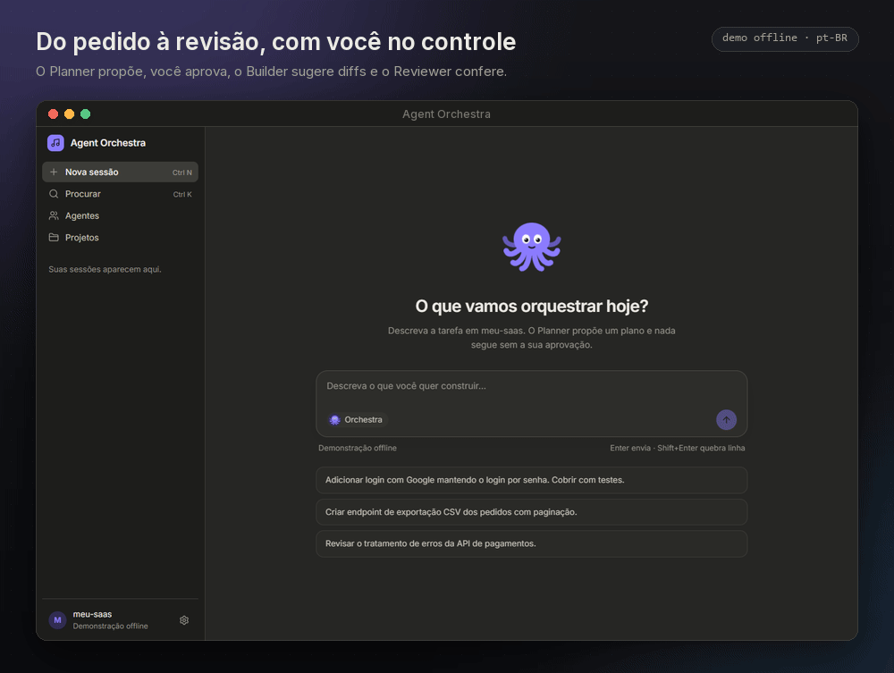
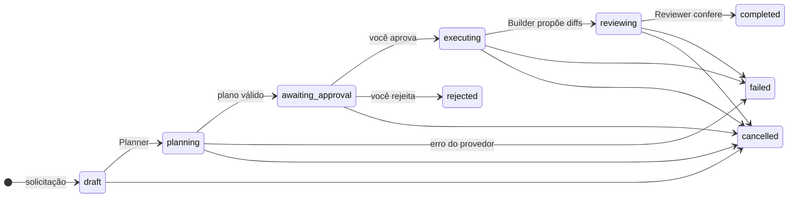
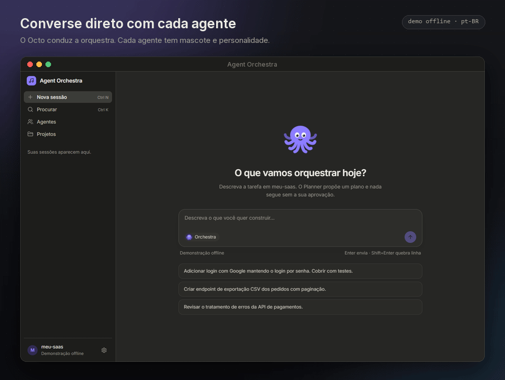
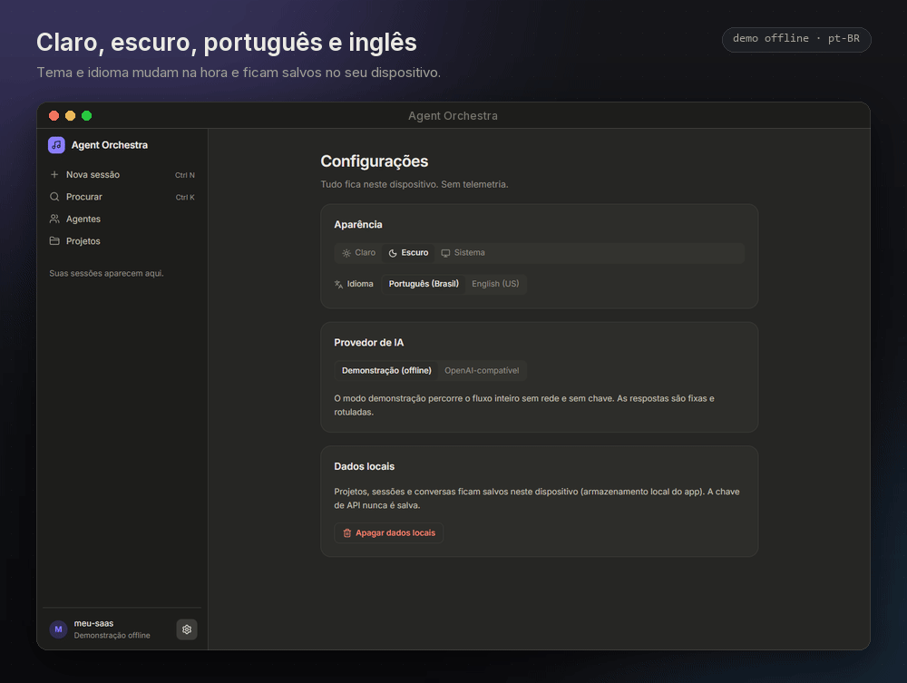

<p align="center">
  
</p>

<p align="center">
  <a href="https://github.com/Efer-Eder/agent-orchestra/actions/workflows/ci.yml"></a>
  <a href="LICENSE"></a>
  <a href="https://efer.online/projeto/agent-orchestra/demo/"></a>
  
  
</p>

<p align="center">
  <a href="https://efer.online/projeto/agent-orchestra/demo/"><b>Abrir a demo</b></a> ·
  <a href="https://efer.online/projeto/agent-orchestra/">Página do projeto</a> ·
  <a href="docs/architecture.md">Arquitetura</a> ·
  <a href="ROADMAP.md">Roadmap</a> ·
  <a href="README.en.md">English</a>
</p>

> [!NOTE]
> **Em desenvolvimento.** O fluxo completo funciona no navegador e no app desktop (Windows), em modo demonstração ou com um provedor de IA de verdade. No desktop, o Builder lê os arquivos da pasta autorizada do projeto (só leitura, depois da sua aprovação). Ainda não há instalador publicado nem execução de comandos. Tudo que aparece aqui existe e roda hoje.

## O que é

Agent Orchestra é um app desktop **local-first** para coordenar agentes de IA no seu fluxo de desenvolvimento. O **Planner** divide o pedido em tarefas, o **Builder** propõe diffs e o **Reviewer** confere. Entre o plano e a execução existe um portão que só você abre.

<p align="center">
  
</p>

## Por que

- **Você decide.** O domínio é uma máquina de estados: a única transição para `executing` passa por `approvePlan()`, que é um clique seu. Tem teste garantindo isso.
- **Seu computador, suas chaves.** Sem telemetria. A chave de API fica no Gerenciador de Credenciais do Windows (ou só na memória, no navegador) e vai direto para o provedor que você escolher.
- **Qualquer modelo.** Funciona com qualquer API compatível com OpenAI, inclusive modelos locais. E tem um modo demonstração que roda o fluxo inteiro sem rede e sem chave.

## Recursos

|                           |                                                                                                                                                                                                |
| ------------------------- | ---------------------------------------------------------------------------------------------------------------------------------------------------------------------------------------------- |
| **Fluxo com aprovação**   | Solicitação → plano → aprovação → execução → revisão → aprovação final, com rejeição, pedido de ajuste e cancelamento a qualquer momento.                                                      |
| **Lê o seu código**       | No app desktop, o Planner escolhe arquivos da pasta autorizada e o Builder lê depois da sua aprovação. `.env`, chaves e `node_modules` nunca são lidos; segredos no código viram `[REDACTED]`. |
| **Diffs, não escrita**    | O Builder só propõe alterações, que você abre no painel lateral. Caminhos fora do projeto (`../`, absolutos, `C:\`, `~`) são recusados.                                                        |
| **Provedor real**         | OpenAI, OpenRouter, Groq, Ollama, LM Studio e afins, com modelo por agente, teste de conexão, nova tentativa em falhas passageiras e mensagens claras para 401, 429, timeout e rede.           |
| **O que cada agente fez** | Cada passo registra modelo, duração, tokens e arquivos lidos. Tokens do modo demonstração aparecem como sintéticos; custo só como estimativa, com os preços que você informa.                  |
| **Agentes com rosto**     | O **Octo** conduz a orquestra e muda de humor com a sessão; Planner, Builder e Reviewer se animam enquanto trabalham. Converse direto com cada um.                                             |
| **Dois idiomas**          | Interface, modo demonstração e respostas dos modelos em **português (Brasil)** ou **inglês (EUA)**.                                                                                            |
| **Claro e escuro**        | Tema claro, escuro ou do sistema, no visual Grafite descrito em [DESIGN.md](DESIGN.md).                                                                                                        |
| **Local-first**           | Projetos, sessões e conversas salvos no dispositivo. Sessões interrompidas voltam marcadas, nada fica "rodando" para sempre.                                                                   |

## Como funciona



Saída de modelo é tratada como **dado não confiável**: plano, diffs e revisão passam por validação de tipos, tamanhos e caminhos antes de aparecer na tela ([`src/providers/parse.ts`](src/providers/parse.ts)).

## Os agentes

<p align="center">
  
</p>

| Agente               | Papel                                                                                      |
| -------------------- | ------------------------------------------------------------------------------------------ |
| **Orchestra** (Octo) | O maestro. Recebe o pedido, chama os outros na ordem certa e só segue com a sua aprovação. |
| **Planner**          | Divide a solicitação em etapas pequenas e verificáveis.                                    |
| **Builder**          | Propõe as alterações como diffs. Nunca aplica nada sozinho.                                |
| **Reviewer**         | Revisa as alterações e aponta riscos, casos de borda e testes que faltam.                  |

## Começando

Você precisa do **Node.js 22+**.

```bash
git clone https://github.com/Efer-Eder/agent-orchestra.git
cd agent-orchestra
npm install
npm run dev
```

Abra <http://localhost:5173>, crie um projeto e descreva uma tarefa. Se quiser só olhar, a mesma build roda em modo demonstração em <https://efer.online/projeto/agent-orchestra/demo/> (use `?lang=en` para inglês).

<details>
<summary><b>App desktop (Windows)</b></summary>

<br />

Requer Rust (MSVC) e as Microsoft C++ Build Tools. Detalhes em [docs/tauri-setup.md](docs/tauri-setup.md).

```powershell
winget install --id Rustlang.Rustup
rustup default stable-msvc
npm run tauri dev
```

Não há instalador publicado nem assinatura de código ainda.

</details>

<details>
<summary><b>Todos os comandos</b></summary>

<br />

| Comando                              | O que faz                                    |
| ------------------------------------ | -------------------------------------------- |
| `npm run dev`                        | App no navegador, em <http://localhost:5173> |
| `npm run tauri dev`                  | App desktop                                  |
| `npm test`                           | Testes (Vitest)                              |
| `npm run lint` · `npm run typecheck` | ESLint e TypeScript                          |
| `npm run build`                      | Build de produção em `dist/`                 |
| `npm run build:site`                 | Página do projeto + demo, em `dist-site/`    |

</details>

## Provedores

Em **Configurações → Provedor de IA**, escolha _OpenAI-compatível_ e informe endereço, modelo e chave.

| Provedor     | Endereço                         |
| ------------ | -------------------------------- |
| Demonstração | nenhum, roda offline             |
| OpenAI       | `https://api.openai.com/v1`      |
| OpenRouter   | `https://openrouter.ai/api/v1`   |
| Groq         | `https://api.groq.com/openai/v1` |
| Ollama       | `http://localhost:11434/v1`      |
| LM Studio    | `http://localhost:1234/v1`       |

`http://` só é aceito para `localhost`. O uso é cobrado pelo provedor, separado de qualquer assinatura de chat.

## Idiomas e temas

<p align="center">
  
</p>

O idioma segue o do sistema na primeira vez, pode ser trocado em Configurações e fica salvo. Os agentes respondem no idioma escolhido. Para contribuir com traduções, as mensagens ficam em [`src/i18n/messages.ts`](src/i18n/messages.ts), e o TypeScript acusa qualquer chave que falte.

## Segurança

- Sem telemetria. A rede só é usada quando você configura um provedor, e só para o endereço informado.
- A chave nunca vai para arquivos do app, logs ou mensagens de erro.
- O shell Tauri não tem plugins de sistema de arquivos, shell ou HTTP. São seis comandos (três para a chave, três de leitura do projeto), cada um com permissão explícita, e uma CSP restritiva.
- Leitura de arquivos só dentro da pasta autorizada: caminhos são canonicalizados (symlinks e junctions incluídos), há lista de negação, limites de tamanho e redação de segredos. Detalhes no [ADR 0009](docs/adr/0009-leitura-de-arquivos-do-projeto.md).
- **Não há sandbox.** Execução de comandos fica fora até existir isolamento demonstrado.

Leia o [modelo de ameaças](docs/threat-model.md) e a [política de segurança](SECURITY.md). Vulnerabilidade: use o relato privado do GitHub, não issue pública.

## Limitações conhecidas

Isto é uma versão alpha. O que ainda não existe ou não foi validado:

- **Nada é gravado no disco.** O Builder só propõe diffs; aplicar alterações ainda não existe.
- **Sem execução de comandos e sem sandbox.** Testes, builds e scripts do projeto não rodam pelo app.
- **Provedor real validado por contrato.** Os testes sobem um servidor HTTP local compatível com a API; uma rodada registrada com chave e modelo reais de cada provedor ainda não existe.
- **Sem streaming.** A resposta aparece inteira quando o modelo termina.
- **A chave passa pelo JavaScript** na hora da chamada. Mover as chamadas HTTP para o lado Rust está no roadmap.
- **Dados em `localStorage`**, não em SQLite. Limpar os dados do app apaga projetos e sessões.
- **Instalador Windows sem assinatura de código.** O SmartScreen avisa na primeira execução; veja [docs/instalacao-windows.md](docs/instalacao-windows.md).
- **Só Windows** foi testado no app desktop. A versão web roda em navegador moderno, sem leitura de arquivos.

## Arquitetura

```text
src/
  domain/      tipos, máquina de estados, contrato do provedor, perfis dos agentes
  providers/   modo demonstração, OpenAI-compatível, validação da saída do modelo
  app/         estado, persistência local, ponte com o cofre do Windows
  i18n/        dicionários pt-BR e en-US, detecção de idioma
  components/  interface (sidebar, sessão, agentes, mascotes, configurações)
src-tauri/     shell desktop em Rust (cofre de chaves, leitura do projeto)
docs/          arquitetura, modelo de ameaças, ADRs 0001 a 0009
```

O domínio é TypeScript puro, sem I/O, com relógio e ids injetáveis para testes determinísticos. Decisões estão em [docs/adr](docs/adr/).

## Roadmap

- [x] Fluxo completo com aprovação, modo demonstração e provedor OpenAI-compatível
- [x] App desktop no Windows com a chave no Gerenciador de Credenciais
- [x] Mascotes, temas claro e escuro, português e inglês
- [x] Ler arquivos do projeto como contexto, com pasta autorizada, lista de negação e redação
- [ ] Aplicar diffs aprovados no disco, com aprovação por arquivo
- [ ] Chamadas HTTP pelo lado Rust, para a chave não passar pelo JavaScript
- [ ] SQLite, exportação de sessão e instalador publicado

Lista completa em [ROADMAP.md](ROADMAP.md) e histórico em [PROGRESS.md](PROGRESS.md).

## Contribuindo

Issues e PRs pequenos são bem-vindos. Antes de abrir um PR, rode `npm run lint`, `npm run typecheck`, `npm test` e `npm run build`. Lógica nova no domínio vem com teste. Veja [CONTRIBUTING.md](CONTRIBUTING.md) e o [Código de Conduta](CODE_OF_CONDUCT.md).

## Licença

[MIT](LICENSE) © 2026 Efer Eder
